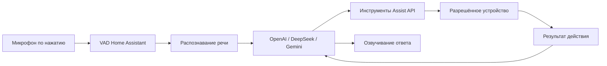

# Провайдеры и голосовые команды

В домашней Docker-установке Habab Home откройте пункт **AI** в боковом меню, маршрут `/habab-ai`. Раздел доступен администраторам. Публичное демо не подключается к этой установке и не получает её ключи.

## Подключение провайдера

Выберите OpenAI, DeepSeek или Google Gemini. Инструкция для выбранного сервиса находится рядом с полями ключа и модели.

| Провайдер | Где получить ключ | Начальная модель |
|---|---|---|
| Habab | Ключ доступа от администратора сервиса Habab | `gemini-3.1-flash-lite` |
| OpenAI | [OpenAI Platform → API keys](https://platform.openai.com/api-keys) | `gpt-4.1-mini` |
| DeepSeek | [DeepSeek Platform → API keys](https://platform.deepseek.com/api_keys) | `deepseek-flash` |
| Google Gemini | [Google AI Studio → API keys](https://aistudio.google.com/api-keys) | `gemini-3.1-flash-lite` |

Имена моделей проверены по документации 22 октября 2026 года. Поле модели можно менять; выбранная модель должна поддерживать вызов инструментов. Доступ к модели, региональные ограничения, баланс и квоты зависят от аккаунта провайдера. Подписка ChatGPT не заменяет оплату OpenAI API.

Нажмите **Проверить и сохранить**. Сервер отправит небольшой платный либо квотируемый запрос выбранной модели. Успех означает, что модель вызвала проверочный инструмент с ожидаемыми аргументами; устройства при этой проверке не меняются. Ответ обычным текстом «OK» не считается успешной проверкой. Ошибки ключа, модели, квоты, сети и времени ожидания показываются в разделе.

Ключ сохраняется в config entry этой установки Home Assistant. Это штатное локальное хранилище Home Assistant; отдельное шифрование ключа в этом изменении не добавлено. Защищайте каталог `/config` и его резервные копии. Ключ не возвращается в списке подключений и не записывается в localStorage. В `/habab-ai` администратор видит сохранённый ключ выбранного провайдера; значок глаза скрывает и показывает его. Панель запрашивает только выбранный ключ через защищённую административную команду. При смене провайдера прежнее значение очищается до загрузки нового, при уходе с панели поле очищается. Для замены введите новый ключ и сохраните подключение. Удаление выполняется через штатный раздел интеграций Habab Home.

## Проверка действия

1. Перейдите по ссылке **Выбрать доступные устройства** и откройте для Assist нужную сущность. Настройте понятные имена и помещения.
2. Вернитесь в AI и выберите подключённого провайдера.
3. Введите команду, например «Выключи свет в гостиной», и нажмите **Выполнить команду**. Это настоящее действие, а не проверка формата фразы.
4. Проверьте состояние устройства на его карточке. В Assist trace доступны вызов инструмента и результат Home Assistant.

Модель получает инструменты встроенного Assist API. Home Assistant обрабатывает их параметры, доступные сущности и действия. Произвольного диспетчера shell-команд или сервисов здесь нет. Ошибка провайдера не переключает запрос на другой сервис. При ошибке после выполненного действия помощник просит проверить состояние перед повтором.

## Облачный провайдер Habab: кандидат с Gemini

В этом кандидате Habab использует нативный протокол Gemini для текста и вызова инструментов. Клиент обращается к сервису Habab; ключ Habab отличается от ключа Google. Выбор Google Gemini, OpenAI или DeepSeek по-прежнему отправляет запросы прямо выбранному провайдеру.

Текстовый клиент Assist и OpenCode используют один адрес `/gemini/v1beta` сервиса Habab и сохраняют нативные идентификаторы, результаты и подписи вызовов инструментов. Для старого подключения Habab с моделью `gpt-4.1-mini` требуется выбрать поддерживаемую текстовую модель Gemini и заново проверить подключение. Модель не заменяется скрыто. Изменение клиента и сервера выпускается согласованно; одна правка названия модели не подтверждает работу сервиса.

Gemini Live для Android использует отдельную модель и протокол. Этот текстовый кандидат не подтверждает физическую голосовую проверку. Habab больше не объявляет прежние OpenAI STT/TTS: старый вызов отклоняется до передачи ключа или аудио. Для браузерного Assist используйте отдельно подключённые OpenAI STT/TTS либо локальные речевые движки. Прямой провайдер OpenAI сохраняет поддержку речи.

## Голос

Текстовый Gemini использует родной API Google напрямую. Модель по умолчанию — `gemini-3.1-flash-lite`; она проверяется безопасным вызовом инструмента при сохранении ключа. Выбранная текстовая модель и модель Gemini Live для совместимой Android-сборки — отдельные настройки. Проверка на сервере не подтверждает работу микрофона и сигналов на телефоне.

Подключение OpenAI создаёт движки `stt` для распознавания речи и `tts` для озвучивания. Выберите провайдера понимания команд и нажмите **Настроить голос для этого провайдера**. Создастся либо обновится его Assist pipeline. Для DeepSeek или Gemini в нём можно использовать речевые движки OpenAI: текстовые команды обрабатывает выбранный провайдер, аудио распознаёт и озвучивает OpenAI. Замена речевого движка выполняется в штатных настройках Assist.

Нажмите **Сказать команду** и разрешите доступ к микрофону. Панель покажет определение речи, распознанный текст и ответ. VAD в Home Assistant определяет начало и конец речи; после паузы запись останавливается. Кнопка **Завершить запись** позволяет закончить её вручную. Максимум записи — 20 секунд. Постоянное прослушивание и wake word в этой панели не включаются. Для браузерного микрофона нужны HTTPS или localhost. Голос ответа генерируется AI.

Распознавание реализовано через OpenAI `whisper-1`, озвучивание — `tts-1`, голос `alloy`. Сейчас речевые сущности объявляют русский и английский. Агенты понимания команд используют язык запроса Assist. Для локальной речи можно отдельно настроить Wyoming/Whisper/Piper; сервисы локальной речи этим изменением не устанавливаются.

## Архитектура и примеры upstream



- [Assist pipeline: стадии, аудио и события VAD](https://contributors.home-assistant.io/core/internals/assist-pipelines/).
- [LLM API: инструменты, контекст и доступ к устройствам](https://contributors.home-assistant.io/core/internals/llm-api/).
- [Нативная интеграция OpenAI](https://www.home-assistant.io/integrations/openai_conversation/) и [Google Gemini](https://www.home-assistant.io/integrations/google_generative_ai_conversation/).
- [Пример цикла tool calling у DeepSeek](https://api-docs.deepseek.com/guides/tool_calls/).
- [Совместимость Gemini с Chat Completions](https://ai.google.dev/gemini-api/docs/openai).
- [Локальные речевые движки через Wyoming](https://www.home-assistant.io/integrations/wyoming/).

Клиент панели использует тот же WebSocket-протокол, что и `src/components/ha-assist-chat.ts`. Преобразование PCM в worklet следует `src/util/recorder-worklet.js`. Обработку смысла команд выполняет выбранная модель; код проверяет идентификаторы инструментов, JSON и лимиты вызовов.

## Проверенный объём

Проверки выполнялись в отдельном localhost Home Assistant 2026.10.2 с виртуальной тестовой лампой. OpenAI и DeepSeek использовали настоящие API. Аудио для микрофона синтетическое; распознавание, VAD, вызов инструментов, изменение сущности и TTS выполнялись настоящими компонентами.

До уточнения инструкции DeepSeek однажды выбрал доступную лампу для отсутствующей цели. После исправления правила проверены неизвестные цели и закрытая сущность. Эти проверки не дают гарантии безошибочного понимания любых команд языковой моделью. Физические устройства, микрофон в комнате, wake word и iOS требуют отдельного аппаратного пилота.

Gemini реализован и проверен на уровне транспорта и интерфейса без настоящего ключа. Успешный живой запрос Gemini не заявляется. Артефакты проверок — `habab/qa/voice/`; ключей и токенов авторизации в них нет.

Автономные проверки протокола и отказов в собранном образе:

```sh
docker build -t habab-home:opencode-20261022 habab/distribution
docker run --rm --network none --entrypoint python3 \
  -v "$PWD/habab/distribution:/diagnostics:ro" habab-home:opencode-20261022 \
  -m unittest discover -s /diagnostics/tests -v

node --test habab/distribution/tests/test-voice-lifecycle.mjs
```

Скрипты `habab/qa/check-voice-live.py` и `habab/qa/check-ai-panel.cjs` требуют отдельного приватного QA runtime и предназначены для изолированного localhost-стенда. Python-зависимости QA входят в `habab/requirements-dev.txt`; используйте проектную `.venv`. Для подготовки PCM-аудио нужен `ffmpeg`. Скрипты выполняют реальные запросы API с расходом квоты. Не запускайте их на действующей домашней установке.
